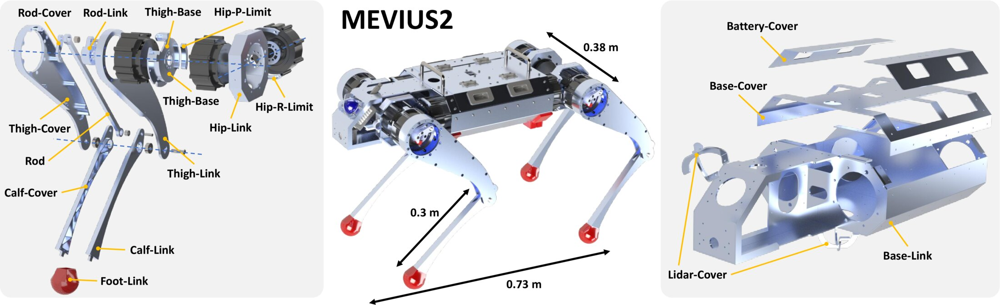

# MEVIUS2
This repository includes the hardware and software components of "MEVIUS2: Practical Open-Source Quadruped Robot with Sheet Metal Welding and Multimodal Perception"

Please refer to the following links for more information.
- [Project Page](https://haraduka.github.io/mevius2-hardware/)
- [arXiv](https://arxiv.org/abs/2603.22031)
- [YouTube](https://www.youtube.com/watch?v=xzfZkmQ2rrQ)

# Hardware

You can find all the hardware components in the following link
- [Goodle Drive](https://drive.google.com/drive/folders/1m8s6-Upx6yeogyJqEuW0Rl8RT7Q_2TD-?usp=sharing)



- [RobStride03](https://robstride.com/products/robStride03)
- [RobStride03 Manual](https://github.com/RobStride/Product_Information/tree/main/Product%20Literature/RS03)
- Motor Index Order: FR(1-3) --> FL(4-6) --> BR(7-9) --> BL(10-12) / Proximal --> Distal
- Link Name: FR_scapula_link --> FR_thigh_link --> FR_calf_link
- Joint Name: FR_collar --> FR_hip --> FR_knee
- IsaacGym Joint Order: BR --> BL --> FR --> FL / collar --> hip --> knee

# Software Dependencies
Please install the following dependencies.
- [ROS](https://www.ros.org/) # if ubuntu >= 22.04, please install [ROS-O](https://github.com/ros-o/ros-o)
- [spacenav_node](https://wiki.ros.org/spacenav_node) # optional
- [virtual_joystick](https://github.com/aquahika/rqt_virtual_joystick) # optional
- [legged_gym](https://github.com/leggedrobotics/legged_gym) # for training
- [livox_ros_driver2](https://github.com/tongtybj/livox_ros_driver2/tree/PR/ros1)
- [FAST_LIO](https://github.com/tongtybj/FAST_LIO/tree/PR/odometry)
- [elevation_mapping_cupy](https://github.com/leggedrobotics/elevation_mapping_cupy)

Please install the following python packages.
- pytorch
- scipy
- can
- mujoco
- mujoco-python-viewer
- urdf_parser_py
- ds4drv (optional)

# Build
```
mkdir -p ~/mevius2_ws/src
cd ~/mevius2_ws/src
git clone git@github.com:haraduka/mevius2.git
cd ..
catkin build
source ~/mevius2_ws/devel/setup.bash
```

## Setup Can Devices
```
udevadm info -a -p /sys/class/net/can0 | grep serial # ATTRS{serial}=="002C00355457530220353930"

# see config/99-usb-can.rules
sudo vim /etc/udev/rules.d/99-usb-can.rules

# add the below command
SUBSYSTEM=="usb", ATTRS{serial}=="002C00355457530220353930", SYMLINK+="can_usb_0"
SUBSYSTEM=="usb", ATTRS{serial}=="001F00275457530120353930", SYMLINK+="can_usb_1"

# then (please plug out and in the device)
sudo udevadm control --reload-rules
sudo udevadm trigger

```

# Reinforcement Learning
```
# in legged_gym
git remote add haraduka git@github.com:haraduka/legged_gym.git
git fetch haraduka
git checkout haraduka/mevius2

python3 legged_gym/scripts/train.py --task mevius2
python3 legged_gym/scripts/play.py --task mevius2 --load_run ( log_dir )
cp logs/mevius2/( log_dir )/exported/policies/policy_1.pt /tmp/policy.pt
roscd mevius2
cp /tmp/policy.pt models/policy.pt

```

# Usage
Please test several codes by running the following command.
```
python3 scripts/mevius2_utils.py
```
Please test the motors by running the following command.
```
./bin/can_setup.sh
python scripts/xiaomimotor_test.py --ids 1 --task sense
```
Please test the real robot by running the following command.
```
# in the PC of MEVIUS2
roscore
sudo ds4drv
roslaunch mevius2 livox.launch
roslaunch mevius2 fast_lio.launch
./bin/can_setup.sh
python3 scripts/mevius2_main.py

# Cross: SITDOWN/STANDUP, Circle: STANDUP/WALK for ps4joy

# if you want to simulate the robot in mujoco
python3 scripts/mevius2_main.py --sim

# please press D to turn off every-step rendering in mujoco viewer
```

# How to Make Models
- make detailed models in solidworks and export as 3dxml
- convert 3dxml to dae using convert-urdf-mesh with --force-zero-origin option
- make simple models in solidworks and export as 3dxml
- convert 3dxml to dae using convert-urdf-mesh with --force-zero-origin option
- make simple models in solidworks and export as stl
- use converted detailed model for URDF, and use simple models for STL and DAE files
- set joint limits, max velocity, max effort, and correct collision models in URDF
- make mevius2_dae.urdf and mevius2_stl.urdf (just each file path is different)
- use mevius2_dae.urdf for rviz and isaacgym (change mesh path), and use mevius2_stl.urdf for mujoco
- cp mevius2_stl.urdf to meshes/mevius2_mujoco.urdf, make collision model the same with visual model, add world link and floating joint
- compile urdf into xml, change a little (stl path, geom name, and default base_link pos) and load from scene.xml

# Acknowledgements
- scripts/isaacgym_torch_utils.py is from [IsaacGym](https://developer.nvidia.com/isaac-gym)
- scripts/legged_gym_math.py is from [LeggedGym](https://github.com/leggedrobotics/legged_gym)

# Citation
```
@article{kawaharazuka2026mevius2,
  title={{MEVIUS2: Practical Open-Source Quadruped Robot with Sheet Metal Welding and Multimodal Perception}},
  author={Kento Kawaharazuka and Keita Yoneda and Shintaro Inoue and Temma Suzuki and Jun Oda and Kei Okada},
  journal={IEEE Robotics and Automation Practice},
  year={2026},
}
```
